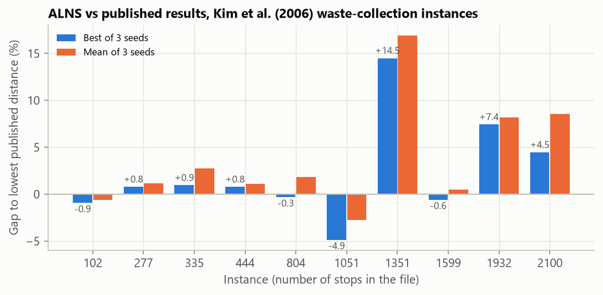
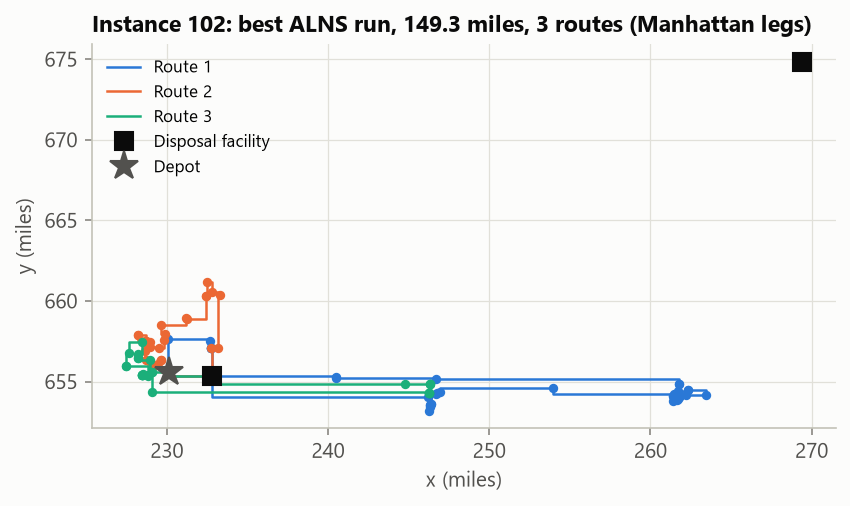
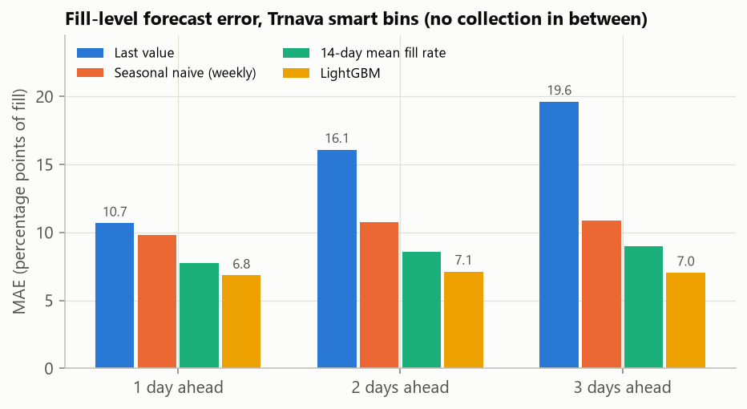
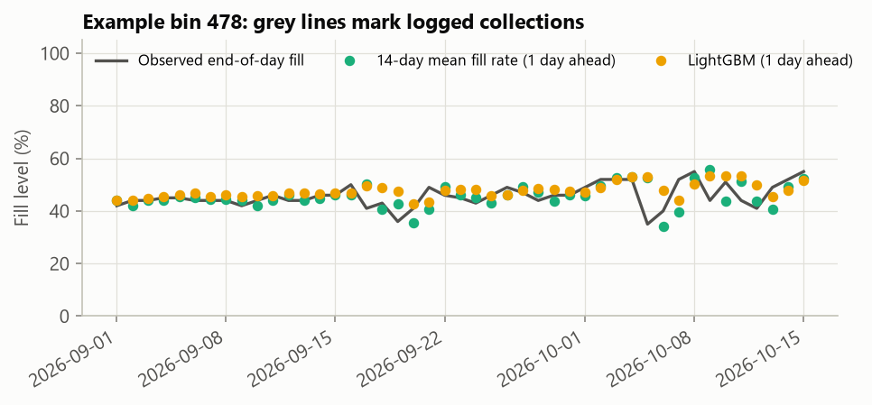
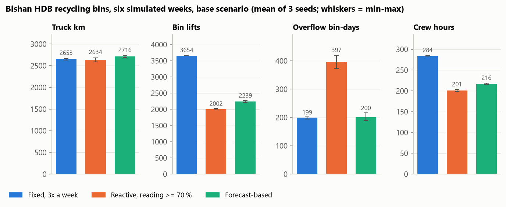
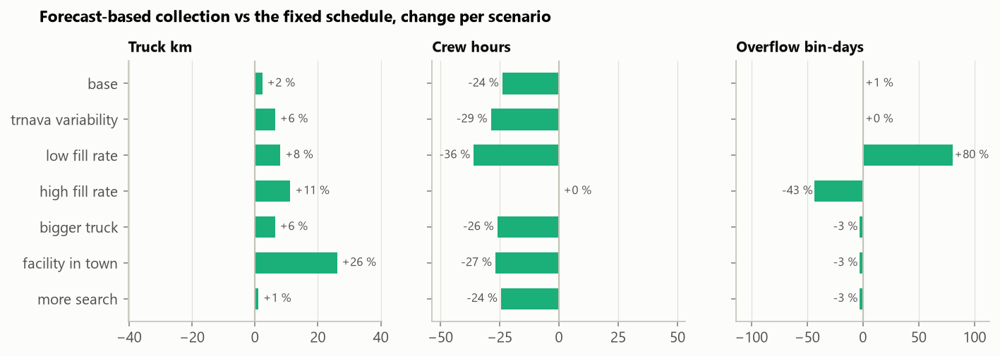
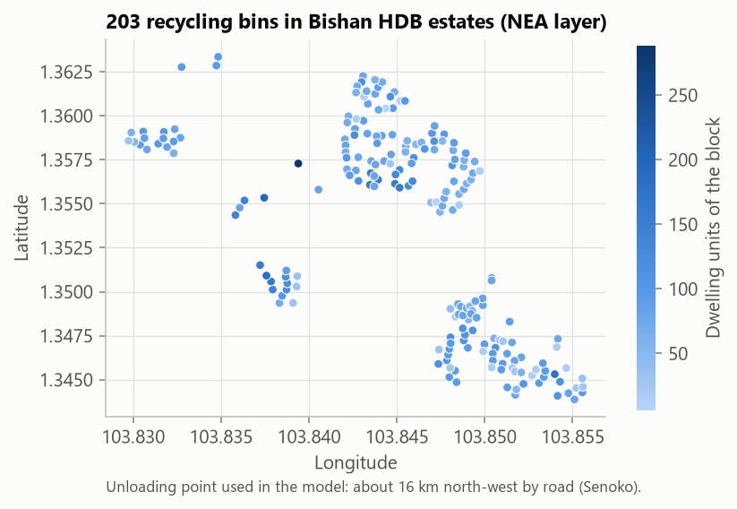
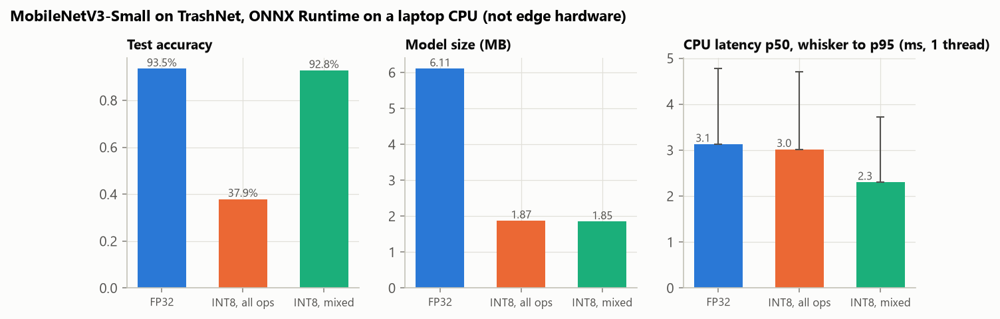

# sg-waste-collection-ai

AI and optimisation for urban waste collection: routing with unloading trips, bin fill-level
forecasting, a Singapore "collect when needed" simulation, an INT8 waste-image classifier, and a
SQL KPI pipeline with a static dashboard.

A personal desk study (November 2026) built from public data and published benchmarks. It is not
a study by, for, or endorsed by the National Environment Agency (NEA) or any waste collector, and
nothing here was measured on a real collection fleet.

## What was found

<!-- BEGIN:findings -->
- **Routing.** ALNS with unloading trips and a driver break on the ten Kim et al. (2006) instances: best of 3 seeds is +0.3 % from the lowest published value on the five instances below 1,000 stops and +4.2 % on the five larger ones (-14.8 % against the original 2006 results). It is not state of the art.
- **Forecasting.** On 486 real smart bins, LightGBM has an MAE of 7.0 points of fill level against 8.4 for the best baseline (14-day mean fill rate) and 14.8 for the last value.
- **Singapore case study (simulation).** For the 203 recycling bins of Bishan's HDB estates, forecast-based collection changes bin lifts by -39 %, crew hours by -24 %, overflow bin-days by +1 % and truck km by +2.4 % against the three-times-a-week schedule (truck km +26 % when depot and unloading point are in town). Under these assumptions collecting when needed saves handling, not distance.
- **Edge classifier.** MobileNetV3-Small on TrashNet: 93.5% test accuracy in FP32. Static INT8 quantisation of the whole network collapses to 37.9%; a mixed-precision model (3 sensitive blocks kept in FP32) reaches 92.8% at 6.1 MB -> 1.8 MB, with CPU p50 latency 3.1 -> 2.3 ms (laptop CPU, 1 thread; no edge device was used).
<!-- END:findings -->

Every number in the generated blocks of this README comes from `results/*.json`
(`python scripts/render_readme.py`; a test fails when the README and the results disagree).

## Contents

| Part | Code | Results |
|---|---|---|
| 1. Routing with intermediate facilities, time windows and a driver break; ALNS vs published values; exact MIP on small cases | `wastecollect/routing/`, `scripts/run_routing_benchmark.py`, `scripts/run_routing_mip.py` | `results/routing_benchmark.json`, `results/routing/runs/`, `results/routing_mip.json` |
| 2. Fill-level forecasting, rolling-origin backtest | `wastecollect/forecast/`, `scripts/run_forecast.py` | `results/forecast_backtest.json` |
| 3. Singapore case study: fixed schedule vs collect when needed | `wastecollect/casestudy/`, `scripts/run_casestudy.py` | `results/casestudy.json`, `results/casestudy_daily.csv` |
| 4. Edge classifier: fine-tuning, ONNX, INT8 static quantisation, CPU latency | `wastecollect/edge/`, `scripts/train_edge_model.py`, `scripts/quantize_edge_model.py` | `models/*.onnx`, `results/edge_model.json`, `results/edge_training.json` |
| 5. KPI pipeline (DuckDB SQL) and dashboard (Plotly, no server) | `wastecollect/pipeline/kpi.sql`, `scripts/build_kpis.py` | `results/kpi/*.csv`, `dashboard/index.html` |

<!-- BEGIN:inputs -->
Committed inputs (`data/inputs/`):

- Trnava smart bins: 490 bins (120 glass, 122 paper, 120 plastic, 123 residual, 5 unknown), 240 days (2026-03-18 to 2026-11-12), 117,491 bin-days, 19,115 logged collections, 8.9 % of bin-days flagged as stale.
- Bishan case study: 203 recycling bins in HDB estates, 180 matched to an HDB block (16,799 dwelling units in total), a 205 x 205 road distance and travel-time matrix from an OSM graph of 86,286 nodes; bins snapped to the road network at 22 m on average.
- TrashNet split: 2,527 file names (1,769 train, 328 validation, 430 test).
- Published reference distances for the routing benchmark, cited Singapore facts (`sg_facts.json`).
<!-- END:inputs -->

## 1. Routing with unloading trips

**Problem.** One depot, a set of disposal facilities, collection stops with a load, a service time
and a time window. A vehicle collects until its capacity is reached, unloads at a facility and may
continue; it must return to the depot empty, so the last stop before the depot is a facility. A
route is also limited in total load and number of stops per day, must respect the depot's
opening hours, and contains one break (one hour, starting between 11:00 and 12:00). The fleet is
homogeneous and unlimited; the objective is total distance. This is the waste-collection VRPTW
of Kim, Kim & Sahoo (2006) with the conventions of Benjamin (2011): Manhattan distance on the
instances' feet coordinates, reported in miles, travel time from the instance's speed, stops with
zero load still visited.

**Method.**

| Module | Content |
|---|---|
| `routing/checker.py` | Independent feasibility checker written as plain loops; tries every break placement explicitly. Shares no code with the search. |
| `routing/routes.py` | Search-side route cache: earliest and latest service starts with and without the break already taken, trip loads between unloads; insertion of a stop, or of a stop together with a new unload, checked in vectorised form. |
| `routing/construct.py` | Nearest-neighbour start: extend the current trip, else unload and start a new trip, else close the route. |
| `routing/alns.py` | Adaptive large neighbourhood search (Ropke & Pisinger 2006): random, worst, Shaw, route and trip removal; greedy, noisy greedy, regret-2 and regret-3 repair; roulette-wheel weights; simulated-annealing acceptance; trips merged and facilities re-chosen afterwards. Adapted from the author's own `delivery-vrptw` repository (MIT). |
| `routing/mip.py` | Vehicle-indexed MIP with facility copies, load reset at facilities, big-M time windows and break binaries, solved with HiGHS (`highspy`). |

**Benchmark.** The ten instances are downloaded by `scripts/fetch_wcvrptw.py` (they carry no
licence file, so they are not redistributed here; see the provenance table).

<!-- BEGIN:routing -->
| Instance | Stops | IFs | Kim 2006 | Benjamin 2011 | Markov 2016 | ALNS best | ALNS mean | Routes (ALNS / ref.) | Gap of best | Gap of mean |
|---|---|---|---|---|---|---|---|---|---|---|
| 102 | 99 | 2 | 205.1 | 156.9 | 150.66 | 149.25 | 149.75 | 3 / 3 | -0.93 % | -0.60 % |
| 277 | 275 | 1 | 527.3 | 454.7 | 444.24 | 447.71 | 449.35 | 3 / 3 | +0.78 % | +1.15 % |
| 335 | 330 | 4 | 205.0 | 186.7 | 177.84 | 179.53 | 182.68 | 6 / 6 | +0.95 % | +2.72 % |
| 444 | 442 | 1 | 87.0 | 79.7 | 77.88 | 78.49 | 78.73 | 11 / 11 | +0.78 % | +1.09 % |
| 804 | 784 | 19 | 769.5 | 641.8 | 594.13 | 592.23 | 605.03 | 6 / 5 | -0.32 % | +1.84 % |
| 1051 | 1048 | 2 | 2370.4 | 2123.8 | not reported | 2020.48 | 2065.47 | 17 / 17 | -4.87 % | -2.75 % |
| 1351 | 1347 | 3 | 1039.7 | 874.7 | not reported | 1001.48 | 1022.76 | 7 / 8 | +14.49 % | +16.93 % |
| 1599 | 1596 | 2 | 1459.2 | 1206.1 | not reported | 1198.96 | 1211.86 | 14 / 13 | -0.59 % | +0.48 % |
| 1932 | 1927 | 4 | 1395.3 | 1127.7 | not reported | 1211.33 | 1219.78 | 18 / 16 | +7.42 % | +8.17 % |
| 2100 | 2092 | 7 | 1833.8 | 1558.1 | not reported | 1627.71 | 1691.38 | 17 / 16 | +4.47 % | +8.55 % |

Distances in miles; 10,000 ALNS iterations, 3 seeds per instance; every run passed the independent checker (yes). Gaps are against the lowest published value that could be read in an accessible source: Markov et al. (2016) for the first five instances, Benjamin (2011) for the other five.
Mean gap of the best run: +0.25 % on the five instances below 1,000 stops, +4.18 % on the five larger ones, +2.22 % over all ten (mean of all runs: +3.76 %). Against Kim et al. (2006) the best run is -14.8 % on average.
The objective here is distance only; on instances 804, 1599, 1932, 2100 the best run uses more routes than the reference solution.
<!-- END:routing -->

A negative gap does not establish a new best-known solution. The paper of Buhrkal, Larsen &
Ropke (2012), which also reports all ten instances, could not be retrieved; its values for the
five larger instances are **not verified** and may be lower than the Benjamin (2011) values used
as reference. The rules implemented here follow the instance files and Benjamin (2011); papers
differ in details (for example where the break may be taken, or whether the number of vehicles
is minimised first), and the published solutions themselves are not available to re-check with
this repository's checker. The published methods also ran on different hardware and budgets, so
this is a comparison of reported values only.





**Exact validation on small instances.** The MIP is solved to proven optimality where possible
(with a time limit per instance), its routes are re-checked by the independent checker, and ALNS
(5 seeds, 300 iterations) is compared with the optimum.

<!-- BEGIN:mip -->
| Group | Instances | MIP proved optimal | MIP routes pass the checker | ALNS = optimum (best of 5 seeds) | ALNS = optimum (all 5 seeds) | ALNS below a proven optimum | Largest gap, best seed | Largest gap, any seed |
|---|---|---|---|---|---|---|---|---|
| SYNTHETIC, 5-7 stops, 2 IFs | 12 | 12 | 12 | 12/12 | 11/12 | 0 | 0.00 % | 0.86 % |
| First 6-10 stops of instance 102 (two capacities) | 6 | 6 | 6 | 6/6 | 5/6 | 0 | 0.00 % | 1.87 % |

MIP time limit: 900 s per instance (solve times are in `results/routing_mip.json`; they depend on the machine).
<!-- END:mip -->

"Optimal" here means optimal among solutions with at most the number of vehicles given to the
MIP (three for the synthetic instances, two or three for the subsets of instance 102); ALNS has
no such limit, and the column "ALNS below a proven optimum" would expose a conflict.

The comparison exposed one defect on each side, both fixed and pinned by regression tests:

- **ALNS.** With the usual rule "remove up to 40 % of the stops", a five-stop instance only ever
  lost two stops per iteration and the search stalled 0.9 to 1.4 % above the optimum. Removing at
  least four stops (or all of them, if fewer) fixed it. For eight stops or more the rule is
  unchanged.
- **MIP.** The first version allowed at most four visits to each facility. On one seven-stop
  instance ALNS then returned a checker-feasible solution 7.1 % below the MIP's "optimum": it
  unloads five times at the same facility. The number of facility copies is now a bound derived
  from the loads (`unload_bound` in `routing/mip.py`), and the MIP reproduces that value.

## 2. Fill-level forecasting

**Data.** Real fill-level readings of the City of Trnava's (Slovakia) smart bins, published as
open data under CC BY 4.0, with the city's log of collections. `scripts/fetch_fill_levels.py`
downloads the hourly history; `scripts/build_fill_inputs.py` reduces it to one row per bin and
local day (end-of-day level, daily maximum and mean, logged collections, and a flag for days on
which a sensor only repeats its last value).

**Question.** At the end of day *t*, how full will the bin be at the end of day *t+h* (h = 1, 2, 3)
if nobody empties it in between? That is what a collect-when-needed planner has to know, so only
windows without a logged collection, without a drop of 20 points or more (unlogged emptying) and
without stale sensor days are evaluated.

**Methods.** Last value; seasonal naive (the same weekdays' rises one week earlier); the mean
daily rise of the last 14 days times the horizon; and one LightGBM model for all bins and
horizons (level, recent rises, rolling means and spread, weekday, days since the last collection,
waste type, the bin's own historical rate), retrained at every weekly origin on earlier data only.

<!-- BEGIN:forecast -->
144,470 forecasts, 486 bins, 24 weekly origins from 2026-06-01 to 2026-11-09 (the model is retrained at each origin on earlier data only). Errors in percentage points of fill level.

| Method | MAE | RMSE | Bias | MAE 1 day | MAE 2 days | MAE 3 days | Full-bin (>= 80 %) precision / recall |
|---|---|---|---|---|---|---|---|
| Last value | 14.81 | 21.00 | -13.54 | 10.68 | 16.09 | 19.63 | 0.94 / 0.27 |
| Seasonal naive (same weekday last week) | 10.43 | 14.69 | +0.21 | 9.84 | 10.78 | 10.90 | 0.54 / 0.67 |
| 14-day mean fill rate | 8.36 | 11.87 | +0.37 | 7.74 | 8.60 | 9.01 | 0.63 / 0.70 |
| LightGBM | 6.99 | 9.97 | +0.74 | 6.84 | 7.13 | 7.04 | 0.77 / 0.62 |

| Waste type | Forecasts | Last value | Seasonal naive | 14-day mean rate | LightGBM |
|---|---|---|---|---|---|
| residual | 31,546 | 19.58 | 10.36 | 8.50 | 7.06 |
| paper | 28,863 | 24.13 | 16.09 | 13.18 | 11.62 |
| plastic | 37,474 | 16.57 | 12.12 | 9.62 | 7.87 |
| glass | 46,578 | 4.40 | 5.61 | 4.26 | 3.36 |

LightGBM beats the best baseline (14-day mean fill rate): MAE difference -1.37 pp, 95 % interval -1.44 to -1.29 (bootstrap over 486 bins).
The weekly seasonal naive is worse than simply repeating the last value for: glass.
<!-- END:forecast -->





## 3. Singapore case study: collect when needed vs a fixed schedule

**Setting.** Blue recycling bins in the HDB estates of one planning area, Bishan. Under the
National Recycling Programme each HDB block has one 660-litre commingled bin collected at least
three times a week ([NEA](https://www.nea.gov.sg/our-services/waste-management/3r-programmes-and-resources/national-recycling-programme));
a trial with fill sensors that prompt collection was announced for one collection sector
([MSE, 4 July 2023](https://www.mse.gov.sg/latest-news/written-reply-to-pq-on-sensors-in-recycling-bins/)).
Bin locations are NEA's "Recycling Bins" layer, block sizes come from HDB Property Information,
road distances from OpenStreetMap.

**Model.** Each day a bin receives deposits proportional to the dwelling units of its block,
with a weekday shape and day-to-day noise; a bin that exceeds its volume overflows. Three
policies are compared on the same random deposits:

- **Fixed**: every bin three times a week (west half Mon/Wed/Fri, east half Tue/Thu/Sat).
- **Reactive**: empty a bin when yesterday's sensor reading is at least 70 %.
- **Forecast-based**: empty a bin when the reading plus the forecast rise until the next
  collection day (mean observed rise of the last 14 days, the best baseline of part 2) would reach
  90 %, or after seven days without collection.

Nobody collects on Sundays. Each day's stops are routed with the ALNS of part 1 (shift 07:00 to
17:00, one-hour break, truck capacity in bin volumes, unloading trips). The fill rate, truck size
and timings are assumptions, varied in the scenarios below.

Where the truck unloads matters. Recyclables go to material recovery facilities
([MSE, 16 February 2021](https://www.mse.gov.sg/latest-news/written-reply-to-pq-on-household-recycling/)),
whose addresses are not in the open data used here (**not verified**). The model therefore uses
the NEA-listed incineration plant at Senoko, the disposal site nearest to Bishan, as a stand-in
for depot and unloading point, and one scenario puts both in the town instead.

<!-- BEGIN:casestudy -->
| Scenario | Policy | Truck km | Bin lifts | Crew hours | Truck shifts | Max trucks/day | Overflow bin-days | Mean fill at lift | CO2e (kg) | km vs fixed | Lifts vs fixed | Hours vs fixed | Overflow vs fixed |
|---|---|---|---|---|---|---|---|---|---|---|---|---|---|
| Base (3 seeds) | Fixed, 3x a week | 2653 | 3654 | 284 | 36.0 | 1 | 199 | 0.47 | 2631 | - | - | - | - |
|  | Reactive (reading >= 70 %) | 2634 | 2002 | 201 | 39.7 | 2 | 397 | 0.85 | 2612 | -0.7 % | -45.2 % | -29.4 % | +99.0 % |
|  | Forecast-based | 2716 | 2239 | 216 | 38.0 | 2 | 200 | 0.77 | 2693 | +2.4 % | -38.7 % | -23.8 % | +0.5 % |
| Trnava-like day-to-day variability | Fixed, 3x a week | 2346 | 3654 | 275 | 36.0 | 1 | 432 | 0.43 | 2327 | - | - | - | - |
|  | Reactive (reading >= 70 %) | 2338 | 1783 | 179 | 37.0 | 2 | 557 | 0.86 | 2318 | -0.4 % | -51.2 % | -34.8 % | +28.9 % |
|  | Forecast-based | 2497 | 1998 | 196 | 37.0 | 2 | 434 | 0.79 | 2476 | +6.4 % | -45.3 % | -28.6 % | +0.5 % |
| Fill rate 0.15 bin/day | Fixed, 3x a week | 2031 | 3654 | 265 | 36.0 | 1 | 51 | 0.35 | 2013 | - | - | - | - |
|  | Reactive (reading >= 70 %) | 2050 | 1569 | 158 | 36.0 | 1 | 162 | 0.82 | 2033 | +0.9 % | -57.1 % | -40.5 % | +217.6 % |
|  | Forecast-based | 2195 | 1707 | 170 | 36.0 | 1 | 92 | 0.76 | 2176 | +8.1 % | -53.3 % | -35.9 % | +80.4 % |
| Fill rate 0.30 bin/day | Fixed, 3x a week | 3150 | 3654 | 299 | 44.0 | 2 | 840 | 0.65 | 3123 | - | - | - | - |
|  | Reactive (reading >= 70 %) | 3265 | 2706 | 259 | 42.0 | 2 | 966 | 0.88 | 3238 | +3.7 % | -25.9 % | -13.6 % | +15.0 % |
|  | Forecast-based | 3505 | 3321 | 300 | 46.0 | 2 | 476 | 0.76 | 3475 | +11.3 % | -9.1 % | +0.4 % | -43.3 % |
| Truck holds 80 bin volumes | Fixed, 3x a week | 1786 | 3654 | 257 | 36.0 | 1 | 195 | 0.46 | 1771 | - | - | - | - |
|  | Reactive (reading >= 70 %) | 1985 | 1994 | 180 | 36.0 | 1 | 373 | 0.85 | 1968 | +11.1 % | -45.4 % | -30.1 % | +91.3 % |
|  | Forecast-based | 1900 | 2232 | 191 | 36.0 | 1 | 189 | 0.77 | 1884 | +6.4 % | -38.9 % | -25.9 % | -3.1 % |
| Depot and unloading point in town | Fixed, 3x a week | 690 | 3654 | 245 | 37.0 | 2 | 195 | 0.46 | 684 | - | - | - | - |
|  | Reactive (reading >= 70 %) | 835 | 1994 | 164 | 36.0 | 1 | 373 | 0.85 | 827 | +20.9 % | -45.4 % | -33.3 % | +91.3 % |
|  | Forecast-based | 870 | 2232 | 180 | 37.0 | 2 | 189 | 0.77 | 863 | +26.1 % | -38.9 % | -26.7 % | -3.1 % |
| 200 ALNS iterations per day | Fixed, 3x a week | 2655 | 3654 | 284 | 37.0 | 2 | 195 | 0.46 | 2633 | - | - | - | - |
|  | Reactive (reading >= 70 %) | 2586 | 1994 | 199 | 40.0 | 2 | 373 | 0.85 | 2564 | -2.6 % | -45.4 % | -30.1 % | +91.3 % |
|  | Forecast-based | 2685 | 2232 | 215 | 39.0 | 2 | 189 | 0.77 | 2662 | +1.1 % | -38.9 % | -24.4 % | -3.1 % |

Six simulated weeks after a 14-day warm-up, 60 ALNS iterations per daily plan; all daily routes passed the checker (yes). Base-scenario range over the three seeds: km 2632-2667 (fixed) vs 2690-2729 (forecast-based); overflow bin-days 195-202 vs 189-217.
<!-- END:casestudy -->

CO2e = truck km x 0.99156 kg/km (UK DESNZ 2025 conversion factors, rigid HGV over 17 t, average
laden); it scales with distance only and ignores idling, lifting and compaction. "Crew hours"
(in `results/casestudy.json` and the dashboard) are driving plus lifting plus unloading time.







**Reading the result.** In this model, collecting when needed saves bin lifts and crew time, not
distance: the trucks still carry the same volume, so the number of trips to the distant unloading
point barely changes, and the fixed schedule already serves two compact halves of the town while
the demand-driven stops are scattered across all of it (with the unloading point in town the
demand-driven policies drive clearly more). In the base scenario the reactive rule without a
forecast overflows about twice as often as the fixed schedule, and the forecast-based rule only
matches the fixed schedule's overflow; at a low fill rate it overflows more, at a high fill rate
less. Giving the router more iterations (last scenario) does not change the picture.

## 4. Edge classifier

MobileNetV3-Small (torchvision, ImageNet weights) fine-tuned on TrashNet (2,527 photographs of
single items on a plain background in six classes; MIT licence) with a fixed stratified
70/13/17 split, exported to ONNX and quantised to INT8 with ONNX Runtime static quantisation
(QDQ format, per-channel INT8 weights, UINT8 activations). The images are not committed
(`scripts/fetch_trashnet.py`); the FP32 and the mixed-precision INT8 ONNX files are.

Post-training quantisation of this architecture did not work out of the box, so
`scripts/quantize_edge_model.py` records the whole path: three calibration methods on the full
network, a block-by-block sensitivity scan, and a mixed-precision model that leaves the sensitive
blocks in FP32.

<!-- BEGIN:edge -->
| Model | Test accuracy | Macro F1 | File size | p50 / p95 latency, 1 thread | p50 / p95 latency, 4 threads |
|---|---|---|---|---|---|
| FP32 | 93.5% | 0.923 | 6.11 MB | 3.1 / 4.8 ms | 1.8 / 10.7 ms |
| INT8, every operator (not committed) | 37.9% | 0.316 | 1.87 MB | 3.0 / 4.7 ms | 2.5 / 3.2 ms |
| INT8, mixed precision (committed) | 92.8% | 0.911 | 1.85 MB | 2.3 / 3.7 ms | 2.5 / 3.0 ms |

430 test images; calibration on 300 training images; every choice below was made on the 328 validation images (FP32 validation accuracy 94.5%).

- **Quantising every operator fails.** Validation accuracy 30.5% (minmax), 39.9% (percentile), 30.5% (entropy); on the test split the best of these reaches 37.9%.
- **Sensitivity scan.** Quantising the convolutions of one block at a time: features.0 27.1%, features.1 39.3%, features.2 70.1%; every other block stays at 93.6% or above.
- **Mixed precision.** Keeping features.0, features.1, features.2 and the activation operators in FP32 and quantising 46 of 54 convolution / linear nodes gives 92.7% on validation and 92.8% on test (-0.7 points against FP32), a file 3.3x smaller, and a 1.36x speed-up on this CPU (p50 3.1 ms FP32 vs 2.3 ms with one thread; with four threads 1.8 ms vs 2.5 ms). The two models agree on 97.0% of test images.

Per-class recall on test (FP32 / mixed INT8): cardboard 0.94 / 0.96, glass 0.91 / 0.88, metal 0.94 / 0.96, paper 0.96 / 0.94, plastic 0.96 / 0.95, trash 0.78 / 0.78.
Latency: ONNX Runtime 1.32.0, CPU execution provider, batch 1, best of three rounds of 300 runs, on 11th Gen Intel(R) Core(TM) i7-11370H @ 3.30GHz (a laptop; **not measured on edge hardware**, where integer kernels may behave differently). Training: 25 epochs, 80 min wall time on a NVIDIA GeForce GTX 1650 shared with other jobs; best validation accuracy 94.5% at epoch 18.
<!-- END:edge -->



TrashNet images are clean studio-like photographs; accuracy on items inside a real bin or on a
conveyor would be lower and was not measured. Quantisation-aware training, which usually fixes
the accuracy loss of full INT8 for this architecture, was not tried.

## 5. KPI pipeline and dashboard

`scripts/build_kpis.py` loads the result tables into DuckDB, runs `wastecollect/pipeline/kpi.sql`
(policy totals and changes against the fixed schedule, weekly series, observed bin behaviour by
waste type, forecast and routing summaries), writes `results/kpi/*.csv` and renders
`dashboard/index.html`, a single static page (Plotly from the CDN, no server; open it in a browser).

## Data provenance

| Input | Label | Source, licence, access date |
|---|---|---|
| Waste-collection VRPTW instances (10 files) | REAL | Kim, Kim & Sahoo (2006); mirror <https://github.com/israelpereira55/WCVRPTW-benchmark> at commit `ad4b010`, accessed 2026-11-15. No licence file (the mirror's README says the benchmark author permitted the mirror): fetched by script, not committed. Original page named in Benjamin (2011): `http://www.postech.ac.kr/lab/ie/logistics/WCVRPTW_Problem/benchmark.html` (not checked). |
| Published distances for those instances | REAL | Benjamin (2011) Tables 3.3(a) and 6.14, <https://bura.brunel.ac.uk/bitstream/2438/5254/1/FulltextThesis.pdf>; Markov, Varone & Bierlaire (2016) Table 4 (preprint <https://infoscience.epfl.ch/record/208988/files/MarVarBier2015.pdf>); both read 2026-11-15; transcribed in `data/inputs/wcvrptw_reference.json`. |
| Small routing instances for MIP checks and tests | SYNTHETIC | `wastecollect.routing.instance.synthetic(seed)`; random points, loads and time windows. |
| Smart-bin fill levels, collection log, station coordinates | REAL | City of Trnava open data, "Smart bin fill level history", <https://opendata.trnava.sk/en/dataset/historia-naplnenosti-smart-kontajnerov>, CC BY 4.0, accessed 2026-11-15; local days 2026-03-18 to 2026-11-12. Committed in reduced form (`data/inputs/fill_*.csv`). |
| Recycling-bin locations | REAL | data.gov.sg "Recycling Bins" (NEA), `d_4dde14826642f49eefff48b7832b90db`, Singapore Open Data Licence v1.0, accessed 2026-11-15. Feature dates in the layer are from 2017; whether every bin still exists is not verified. |
| Dwelling units per block | REAL | data.gov.sg "HDB Property Information" (HDB), `d_17f5382f26140b1fdae0ba2ef6239d2f`, Singapore Open Data Licence v1.0, accessed 2026-11-15; joined on block number and street. Unmatched bins get the median (flagged in `sg_casestudy_nodes.csv`). |
| Town boundary | REAL | data.gov.sg "Master Plan 2019 Planning Area Boundary (No Sea)" (URA), `d_4765db0e87b9c86336792efe8a1f7a66`, Singapore Open Data Licence v1.0, accessed 2026-11-15. |
| Unloading-point coordinates | REAL | data.gov.sg "Waste Disposal Site" (NEA), `d_4b6f69760d43000af97708ca7367c334`, accessed 2026-11-15 (the dataset notes it was last updated in 2018); NEA's infrastructure page lists the Senoko plant as operating (accessed 2026-11-15). |
| Unloading point and depot being at that plant | ASSUMPTION | Stand-in: the real destination of recyclables (a material recovery facility) is not in the open data used. Scenario "depot and unloading point in town" brackets it. |
| Road network, distances | REAL | OpenStreetMap contributors, ODbL 1.0, BBBike Singapore extract of 2026-11-14, <https://download.bbbike.org/osm/bbbike/Singapore/>, accessed 2026-11-15. The distance and time matrices in `data/inputs/` are a derived database under ODbL. |
| Truck speeds | ASSUMPTION | min(OSM maxspeed or class default, 70 km/h) x 0.8. |
| Collection frequency of the fixed schedule | REAL | NEA National Recycling Programme page: at least three times a week for 660 L bins (accessed 2026-11-15). The split into two halves and the weekdays are an ASSUMPTION. |
| Fill rate, 0.20 bin volumes per day for a block of average size | ASSUMPTION | No public measurement found. Scenarios 0.15 and 0.30. Published statistics only give a loose upper bound in kg (see `plausibility` in `results/casestudy.json`). |
| Weekday shape of deposits | ILLUSTRATIVE | Mean valid daily rise by weekday of Trnava paper and plastic bins (another country; shape only). |
| Day-to-day variability, CV 0.5 | ASSUMPTION | The Trnava increments have a higher CV (they include sensor noise); used as a scenario (ILLUSTRATIVE). |
| Sensor noise, 3 points | ASSUMPTION | |
| Truck capacity 40 bin volumes, 3 min per lift, 20 min unloading, shift 07:00-17:00, break | ASSUMPTION | Scenario with 80 bin volumes. |
| Policy parameters (70 %, 90 %, 7 days) | ASSUMPTION | Not tuned. |
| CO2e per km | REAL | UK DESNZ, Greenhouse gas reporting: conversion factors 2025 (flat file), HGV (all diesel), rigid > 17 t, average laden: 0.99156 kg CO2e/km; Open Government Licence v3.0; <https://www.gov.uk/government/publications/greenhouse-gas-reporting-conversion-factors-2025>, accessed 2026-11-15. Applying a UK average to a Singapore recycling truck is an ASSUMPTION. |
| NEA / MSE statements and waste statistics | REAL | URLs and wording in `data/inputs/sg_facts.json`, accessed 2026-11-15. |
| Waste images | REAL | TrashNet, Thung & Yang (2016), <https://github.com/garythung/trashnet> at commit `6fa2b87`, MIT licence, accessed 2026-11-15; fetched by script, not committed; the split list (file names) is committed. |
| Pretrained weights | REAL | torchvision `MobileNet_V3_Small_Weights.IMAGENET1K_V1`. Licence terms of the ImageNet-trained weights: not verified. |
| Latency | REAL | Measured on the development laptop's CPU. No edge device was used. |

## Reproduce

```bash
python -m venv .venv && . .venv/Scripts/activate     # or bin/activate; Python 3.11
pip install -r requirements.txt
python -m pytest -q                                  # tests, including reduced re-runs of each part
python scripts/run_all.py                            # rebuilds results, KPI tables, dashboard, README blocks
```

`run_all.py` needs only committed inputs. Three things need downloads (and one a GPU) and are
therefore separate, documented steps whose outputs are committed:

```bash
python scripts/fetch_wcvrptw.py && python scripts/run_routing_benchmark.py    # hours; 3 seeds x 10 instances
python scripts/run_routing_mip.py --group kim102
pip install -r requirements-edge.txt
python scripts/fetch_trashnet.py && python scripts/train_edge_model.py && python scripts/quantize_edge_model.py
```

The committed inputs themselves are rebuilt from the raw downloads with `scripts/fetch_fill_levels.py`
+ `scripts/build_fill_inputs.py` and `scripts/fetch_sg_inputs.py` + `scripts/build_sg_inputs.py`
(`requirements-build.txt`). The live sources change (the Trnava API revises recent days, the
OSM extract is daily), so the committed inputs are the reference.

Seeds are fixed everywhere and budgets are counted in iterations, not seconds (the MIP time limit
is the exception). Checks made while writing this: the full forecasting backtest and the base
case-study scenario were run twice with identical results; four of the thirty stored benchmark
runs (instances 102 and 444, seeds 1 and 2) were re-executed with the final code and reproduced
the stored routes exactly; and the test suite, including the reduced re-runs, passes on Windows
11 and on Ubuntu 24.04 (WSL), both with Python 3.11 and the pinned requirements. GPU training is
seeded but not bit-reproducible; the committed ONNX files are the reference for part 4, and INT8
outputs can differ slightly between CPU instruction sets.

## Tests

<!-- BEGIN:tests -->
`python -m pytest -q` collects 71 tests. Mutation testing (`python scripts/mutation_test.py`): 58/58 planted defects killed.
<!-- END:tests -->

The tests are offline: hand-worked routes (capacity, time windows, unloading, break placement),
agreement between the search code and the independent checker on random routes and every
insertion move, MIP optima re-checked and matched, hand-worked forecast metrics and sample rules,
a hand-worked toy town for the simulator, hand-computed KPI SQL results, preprocessing and
metric checks for the classifier, reduced re-runs of parts 1 to 3 compared with committed
results, and the ONNX models against stored outputs. CI (`.github/workflows/tests.yml`) runs them
on Ubuntu with Python 3.11.

Mutation testing plants one defect at a time in the routing checker, the search-side checks,
the parser, ALNS, the MIP, the forecast preparation and metrics, the simulator, the KPI SQL, the
image preprocessing and the hashing helper, and requires a test to fail. The first full pass left
one survivor (a baseline that ignored the forecast horizon was hidden by clipping at 100 % in the
test data); the test was strengthened and the report in `results/mutation_report.json` is from
the final code. Mutations are hand-picked, so the score says the tests bite on those defects, not
that the code is free of others.

## Limitations

- **Routing.** Not a state-of-the-art solver; three seeds per instance; reference values for the
  five larger instances come from a 2011 thesis and a 2012 paper with possibly better values was
  not retrievable. The MIP proves optimality only for a handful of stops.
- **Forecasting.** One city, eight months, sensors that drop out (stale days are excluded, which
  flatters every method equally). The evaluation covers collection-free windows only; it does not
  forecast when collectors come. Errors within a bin are correlated; the interval is a bin-level
  bootstrap. Trnava's bins and habits are not Singapore's.
- **Case study.** A simulation on assumed fill rates, truck size, timings and unloading location;
  no operator data, no traffic, no contamination, no side-loader bins, one town. Daily plans use
  the true amounts in the selected bins and a short ALNS budget. Results are relative comparisons
  under these assumptions, not predictions for Bishan.
- **Edge model.** Evaluated on TrashNet's own test split (same photographic conditions as the
  training images); latency on a laptop CPU, not on a microcontroller or single-board computer;
  no power measurement.
- **Scope.** No live data feed, no cloud deployment and no hardware were part of this study.

## References

- Benjamin, A.M. (2011). *Metaheuristics for the waste collection vehicle routing problem with time windows*. PhD thesis, Brunel University.
- Benjamin, A.M., Beasley, J.E. (2010). Metaheuristics for the waste collection vehicle routing problem with time windows, driver rest period and multiple disposal facilities. *Computers & Operations Research* 37, 2270-2280. doi:10.1016/j.cor.2010.03.019
- Buhrkal, K., Larsen, A., Ropke, S. (2012). The waste collection vehicle routing problem with time windows in a city logistics context. *Procedia - Social and Behavioral Sciences* 39, 241-254. doi:10.1016/j.sbspro.2012.03.105 (not retrieved)
- Howard, A. et al. (2019). Searching for MobileNetV3. *ICCV 2019*.
- Ke, G. et al. (2017). LightGBM: a highly efficient gradient boosting decision tree. *NeurIPS 2017*.
- Kim, B.-I., Kim, S., Sahoo, S. (2006). Waste collection vehicle routing problem with time windows. *Computers & Operations Research* 33(12), 3624-3642. doi:10.1016/j.cor.2005.02.045
- Markov, I., Varone, S., Bierlaire, M. (2016). Integrating a heterogeneous fixed fleet and a flexible assignment of destination depots in the waste collection VRP with intermediate facilities. *Transportation Research Part B* 84, 256-273. doi:10.1016/j.trb.2015.12.004
- Ropke, S., Pisinger, D. (2006). An adaptive large neighborhood search heuristic for the pickup and delivery problem with time windows. *Transportation Science* 40(4), 455-472.
- Thung, G., Yang, M. (2016). Classification of trash for recyclability status. Stanford CS229 project report.

## Licence

Code: MIT (see `LICENSE`). Data keep their own licences as listed above: Trnava data CC BY 4.0
(attribution: City of Trnava); Singapore data under the Singapore Open Data Licence v1.0
(contains information from the datasets named above, accessed on 2026-11-15 from data.gov.sg);
OpenStreetMap-derived matrices under ODbL 1.0 (© OpenStreetMap contributors).
